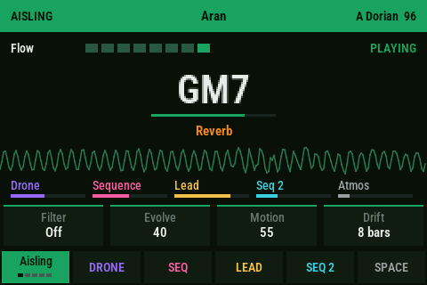
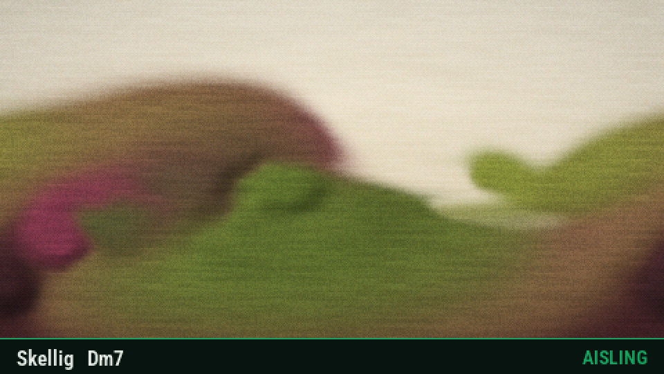

# AISLING for VIBE FM



AISLING is a generative Irish ambient instrument: harps in a jig's threes over a held drone, a flute, a fiddle, a
chanter or a voice leading, and the weather of the west coast behind them. Eight pieces play themselves for ever, and
you can play along. It began as a firmware for the M-VAVE FM-1 (the rest of this repository); this folder is the same
engine as a native VIBE FM firmware, with what the VIBE has and the FM-1 has not.



By CU_STE. A fork of [NACHTFAHRT](https://github.com/FartyPants/fm1-nachtfahrt) by FartyPants, itself after DUB-1 and
AMB-1 by Charles Vestal. GPL-3.0, as they are: see [LICENSE](../LICENSE) and [LICENSING.md](../LICENSING.md).

## What the VIBE adds

- **Audio in.** IN 1 and IN 2 join the music before the effects, so the piece's echo and reverb, the sixteen held
  effects and the moves play on a voice or a guitar as they do on the harps. K1 switches the inputs in and out; the
  Input page sets their level and how much goes through dry.
- **The screen.** The piece, its key and tempo, where it is in its arc, the chord sounding, a scope, the five layers'
  levels and the page's four knobs, all at once.
- **The landscape** (1.1). K5 (or MENU) turns the screen into a painting of the piece as it plays: the Lead in the sky,
  Sequence 2 in the hills, the Sequence in the fields and the Drone in the bog. Pitch sets where a note lands,
  velocity how much paint, tempo the wind. K3 changes its colours (heather, atlantic, kells, evening) and K4 its
  ground (vellum, night, mist). Hosts with a stage show it there too, twice the size, beside the panel. It is the
  painting from the [AISLING visualiser](https://github.com/stephencummins/aisling-viz-box), running inside the
  firmware.
- **Sixteen pads.** One held effect each, in four rows: echo, filter, space and moves.
- **Six page keys.** F1 to F6 choose a layer (Piece, Drone, Sequence, Lead, Sequence 2, Space); the same key again
  turns to the layer's next page. 26 pages of four knobs, with no menu.
- **Six encoders.** 1 to 4 are the page's four; A is the layer's voice and B its level; DATA walks the page.
- **Saving.** What you change in a piece is kept with that piece, and is there the next time. In a DAW it travels with
  the song. K2 twice puts a piece back as it was written.
- **The DAW.** The host's tempo and position lead the piece: it starts with the song and stays on its beat. 24
  parameters to automate: the four master actions (Filter, Wet, Energy, Chorus), the five layers' levels, echo and
  reverb, tempo, root, mode and more.
- **MIDI.** Notes in play the Lead; a MIDI clock in leads the tempo; with MIDI out on, the piece's notes go out.
  From 1.3 a sequencer can play the layers: see "From a sequencer" below.

## Playing it

| | |
|---|---|
| White keys | play the Lead, always in the piece's scale |
| Black keys | an effect or a move, while held |
| Pads | hold an effect |
| F1 to F6 | a layer's pages; again for its next page |
| Encoders 1 to 4 | the page's four knobs |
| Encoder A, B | the layer's voice, the layer's level |
| DATA | walk the page |
| < > | the piece before, the piece after |
| PLAY, STOP | play or rest (the tails ring on) |
| REC | hold the dub |
| K1 | IN 1 and IN 2 into the effects |
| K2, twice | the piece as written |
| K5, or MENU | the landscape, or the panel |
| K3, K4 | the landscape's colours, its ground |
| HOME | this list, on the screen |

The eight pieces: Skellig, Burren, Aran, Carolan, Blasket, Samhain, Connemara, Tir na nOg.

## From a sequencer (1.3)

A DAW's clip, or a live-coding tool, can play AISLING as an instrument while the piece goes on.

| MIDI | |
|---|---|
| Channel 1, and 5 to 16 | the Lead, in the piece's scale (as before) |
| Channel 2 | the Lead, the notes as sent |
| Channel 3 | the Sequence, plucked, the notes as sent, by their velocity |
| Channel 4 | Sequence 2, the same (silent in a piece that has none: Skellig, for one) |
| Program change 1 to 8 | the piece (0 to 7 on the wire) |

The parameter **Own notes** (`own`) holds back the notes the piece plays by itself on the Sequence, on Sequence 2 or
on both, so that only yours sound there. The Lead needs no switch: it stops its own phrase when you play it and
takes it up again two bars after you stop. The Drone and the Atmosphere always play.

The tempo follows the host from 60 to 160; outside that it stays at the nearest end.

### In Strudel (strdltn Live[code])

[strdltn](https://github.com/alienmind/strdltn) plays VIBE FM firmwares from Strudel in VS Code:

    firmware('https://github.com/stephencummins/vibe-aisling/releases/latest/download/aisling.zip')
    $bass: note("<d2 d2 bb1 c2>*2").s("vibefm1:aisling").midichan(3)
    $tune: note("d4 f4 a4 g4").s("vibefm1:aisling").midichan(2)

`.midichan()` chooses the layer, `.velocity()` how hard a Sequence is plucked, `.progNum(0)` to `.progNum(7)` the
piece. Own notes and the other parameters are sliders in its Devices tab. Effects written on the line (`.room()`
and the like) do not reach a firmware. A longer example: [examples/aisling.strudel](examples/aisling.strudel).
Loaded from The Firmware Hub's address the sound is named after the hub's file, not `vibefm1:aisling`.

## Building it

It needs the [VIBE FM SDK](https://thefirmwarehub.com/lab/) (SDK 27 or later) and Zig 0.13. From the SDK's folder:

```
sh tools/build.sh /path/to/this/repository/vibe/aisling
node tools/vibe-check.mjs build/aisling.wasm
```

`build/aisling.wasm` is the firmware; `build/aisling.zip` is the firmware with its card and icon, to drop onto the
VIBE FM plugin's window.

The engine is the FM-1's own source (`firmware/src/dsp`), compiled as it is. At 44.1 kHz its samples go out
unchanged; at any other rate a windowed-sinc resampler takes them to the host's. The landscape only watches the
notes: the sound is the same, to the bit, whether it is drawn or not.
